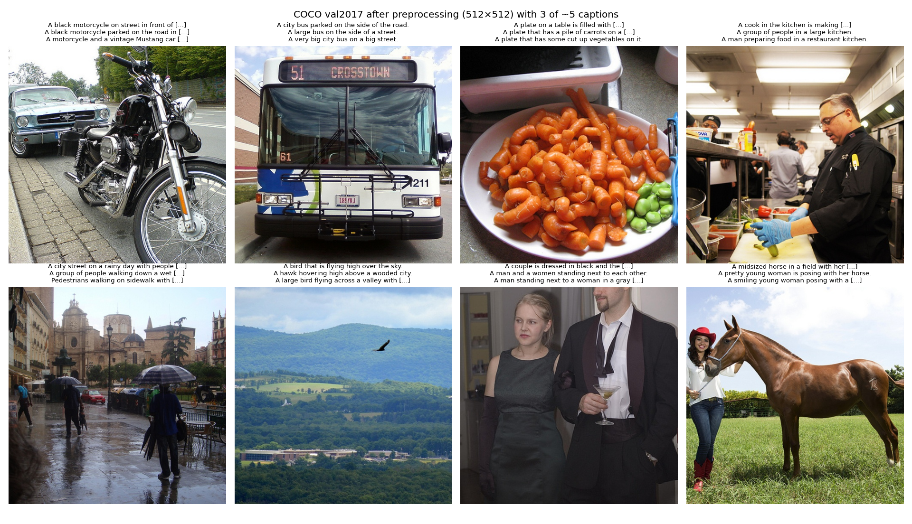
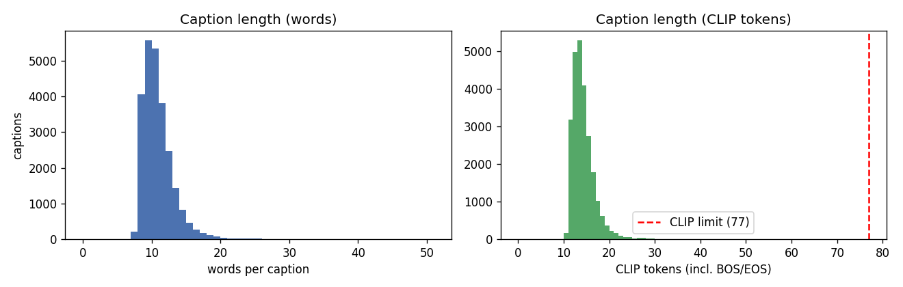
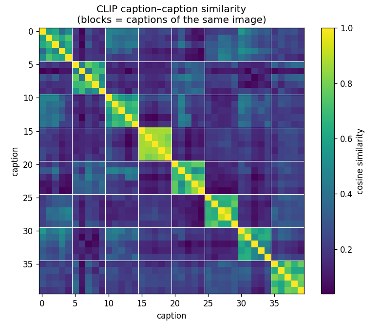
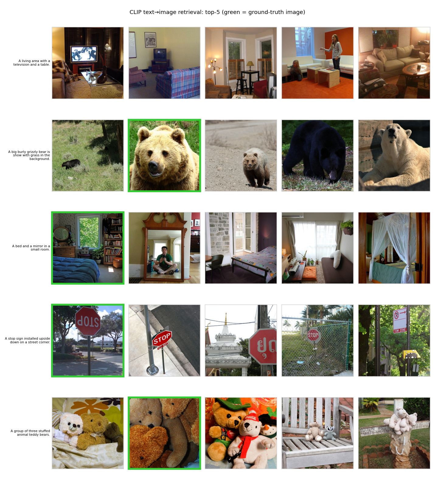
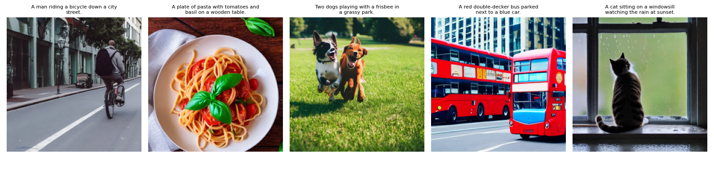
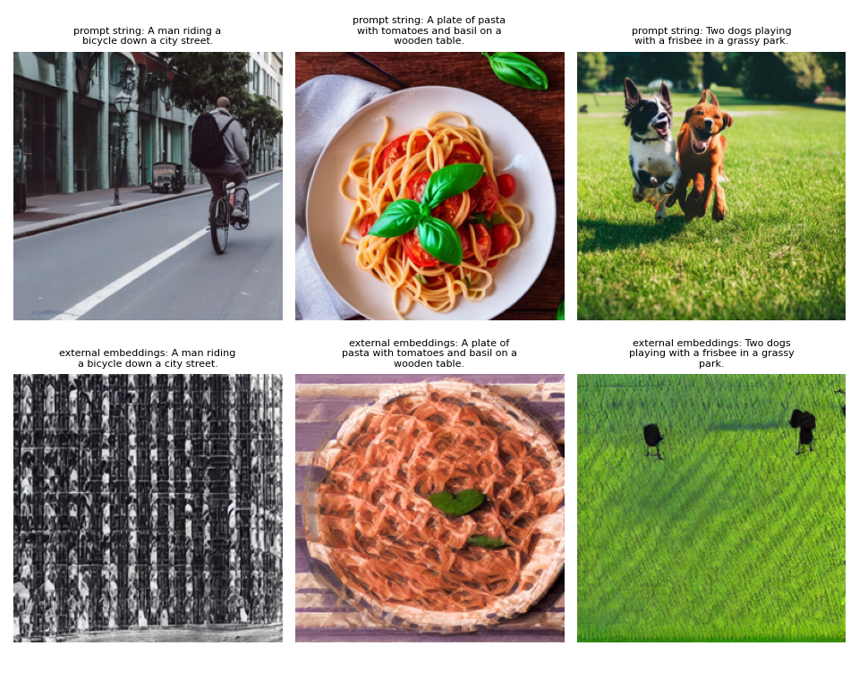
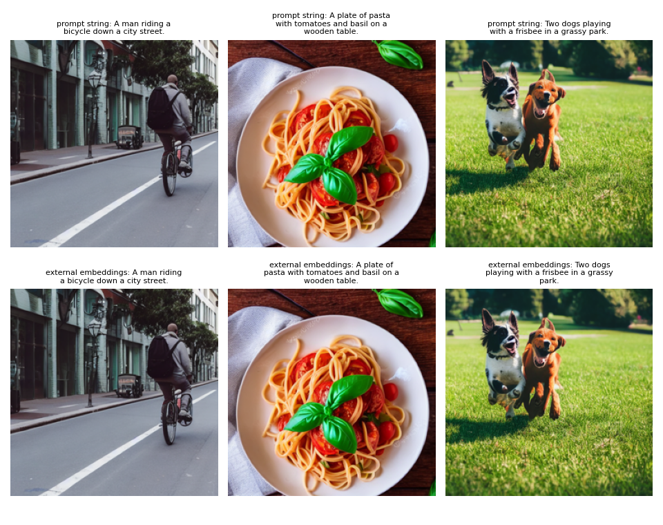

# Milestone 1: Project Proposal and Setup

## From Words to Worlds: Text-to-Image Generation with Transformers and Diffusion

IE 7615 Generative Project, Fall 2026, Northeastern University\
Submitted November 6, 2026

**Group 1**

| Name | NUID |
|---|---|
| Anshuman Singh | 002590892 |
| Rohan Prakash Krishna Prakash | 002317798 |
| Sree Ramya Pasala | 002301508 |

GitHub repository: <https://github.com/anshuman-dataverse/text-to-image-generation>. The shared code is in `src/t2i/`, the Milestone 1 scripts are in `scripts/milestone1/`, and their results, figures and logs are in `outputs/milestone1/`. File names like `results/pairs_manifest.csv` in this report are relative to that folder. The whole milestone can be rerun on Google Colab with [notebooks/milestone1_colab.ipynb](../../notebooks/milestone1_colab.ipynb). The one-page proposal is in [Milestone1_Proposal.pdf](Milestone1_Proposal.pdf).

## 1. Introduction

Our project connects a Transformer text encoder to a pre-trained diffusion model and looks at how the way we condition the model affects the images it produces. We use the text encoder of CLIP ViT-L/14 and Stable Diffusion v1.5. Over the semester we will vary the classifier-free guidance scale, the noise scheduler, the number of sampling steps and the text encoder. For each setting we will measure image quality (FID and Inception Score), how well the image matches the prompt (CLIP score) and how varied the images are, and we will also judge the images by eye.

For this first milestone we prepared the dataset, set up the environment, built the pipeline that turns text into embeddings, checked that those embeddings make sense, and generated our first five images. Everything ran end to end on a Colab Tesla T4. After cleaning we have all 5,000 COCO val2017 images and 25,000 of the 25,014 captions, and a working subset of 5,000 image-caption pairs. Captions of the same image are much more similar to each other than captions of different images (mean cosine similarity 0.656 against 0.234), and CLIP picks the correct image for a caption out of 1,000 candidates 54.9% of the time. Stable Diffusion needed 6.7 seconds per image. The five test images look realistic but already show two problems we want to study: an object left out of the image and a color applied to the wrong object. We also found and fixed a bug in how we passed our own embeddings to the model (Section 5.1).

## 2. Dataset

### 2.1 Choice of dataset

We chose the 2017 validation split of MS COCO Captions. It contains 5,000 photos of everyday scenes covering 80 object categories, and each photo has about five captions written by people (25,014 in total).

Three things made COCO the best fit. Most text-to-image papers report FID against this set, so our numbers can be compared with published ones. Its scenes usually contain several objects, which tests whether the model follows the whole prompt and not just the main subject. And 5,000 images is within the 1k to 5k range given in the assignment, so we did not need the 18 GB training split. We also considered Flickr30k, but it is mostly photos of people and is rarely used for FID. We ruled out a LAION-400M subset because its captions are noisy web alt-text and many of its image links no longer work, which would make our subset hard for anyone else to rebuild.

### 2.2 Cleaning and preprocessing

The script `scripts/milestone1/01_prepare_data.py` downloads COCO and cleans it. For each caption we normalize whitespace, capitalize the first letter and end it with a single period. We then drop captions shorter than three words and remove exact duplicates within an image. In practice no caption was too short and 14 were duplicates, which leaves 25,000 captions.

From this pool we built the working subset by picking one caption per image at random (seed 42), giving 5,000 pairs. While checking the pairs we noticed 14 captions that annotators had left as placeholders, such as "I am unable to see an image above.", so the selection skips them. The file `results/pairs_manifest.csv` lists the image ID, caption ID, file name and caption for every pair.

Images are converted to RGB, resized so that the shorter side is 512 pixels (bicubic), and center-cropped to 512×512, which is the resolution Stable Diffusion v1.5 was trained at. For the model they are converted to tensors and normalized to [-1, 1], the input range of the VAE. Captions are tokenized with CLIP's BPE tokenizer and padded to 77 tokens.

Table 1. Dataset statistics (`results/dataset_stats.json`).

| Statistic | Value |
|---|---|
| Images / captions after cleaning | 5,000 / 25,000 (from 25,014) |
| Image-caption pairs in the working subset | 5,000 |
| Captions per image | 5.0 |
| Words per caption, mean (min to max) | 10.44 (7 to 50) |
| CLIP tokens per caption, mean / max | 13.78 / 58 |
| Captions truncated at 77 tokens | 0 |
| Image size | 512×512 |

COCO captions are short and literal, about ten words on average, so the 77-token limit is never reached. The more important limitation is what the captions describe. They talk about ordinary scenes and never mention an artistic style, so COCO is a good test of whether the right content appears in the image and a poor test of style control.

We also checked the 5,000 pairs themselves (`results/subset_checks.json`). Every image exists and opens at 512×512, no caption is empty or a placeholder, and no image ID or caption ID appears twice. Twenty-one caption texts are shared by two or three different images, for example "A man holding a tennis racquet on a tennis court." These are genuine captions of different photos, so we kept them. The full pool of 25,000 captions is used for the embedding checks in Section 4, and the 5,000 pairs will be the generation and evaluation set in Milestones 2 and 3.

## 3. Model and environment

Table 2. Components of the pipeline.

| Component | Model | What it does |
|---|---|---|
| Text encoder | CLIP ViT-L/14 text transformer (123M parameters, 12 layers) | turns a caption into per-token embeddings (77×768) and a pooled embedding (768) |
| Denoiser | SD v1.5 U-Net (860M parameters) with cross-attention | predicts the noise ε(x_t, t, c) while attending to the 77×768 text embeddings |
| Autoencoder | SD v1.5 VAE | maps a 512×512×3 image to a 64×64×4 latent and back |
| Schedulers | DDIM, DDPM, PNDM, Euler, Euler ancestral, DPM-Solver++ | different samplers for the reverse diffusion, all using the noise schedule SD was trained with |

To generate an image, CLIP encodes the prompt, the U-Net removes noise from a random latent over a number of steps while attending to the prompt embeddings, and the VAE decodes the final latent into a 512×512 image. With classifier-free guidance the U-Net is run twice at each step, once with the prompt and once with an empty prompt, and the two noise predictions are combined as ε̂ = ε(x_t, ∅) + w · (ε(x_t, c) − ε(x_t, ∅)). A larger guidance scale w makes the image follow the prompt more closely but makes images for the same prompt less varied.

We wrote our own wrapper around the text encoder (`src/t2i/embeddings.py`) instead of letting the Diffusers pipeline encode the prompt, and `src/t2i/generate.py` passes its output to the U-Net as `prompt_embeds`. This lets us replace or change the text representation in later milestones, for example by using BERT, interpolating between prompts or weighting parts of a prompt.

**Environment.** We use Python with PyTorch (2.1 or newer) and torchvision, Hugging Face Diffusers (0.30 or newer) for Stable Diffusion and the schedulers, and Hugging Face Transformers (4.44 or newer) for CLIP. From CLIP we use the tokenizer, the text encoder and the image encoder, which we need for the retrieval check. Accelerate and safetensors are used for loading the models, and the complete list is in `requirements.txt`. All runs used Google Colab with a Tesla T4 GPU (16 GB) in half precision. The notebook installs the requirements, mounts Google Drive to store the COCO data and the outputs, and records the git commit of the code at the top of every log in `logs/`. Both models are public on the Hugging Face Hub, so no access token is needed.

## 4. Text-to-embedding pipeline and checks

The script `02_encode_captions.py` runs every caption through the CLIP text encoder and saves two outputs. The per-token embeddings (77×768) are what the U-Net reads through cross-attention, and the pooled embedding (768) is a single vector per caption that we use for comparisons. Before relying on these embeddings for generation, we ran two checks in `03_embedding_checks.py`:

1. Caption similarity. Captions of the same image should be closer to each other than captions of different images.
2. Text-to-image retrieval. CLIP's text and image encoders map into the same space, so each caption should find its own image among a set of candidate images.

Table 3. Embedding checks (`results/embedding_checks.json`).

| Check | Result |
|---|---|
| Mean cosine similarity, captions of the same image (1,000 images, 5,000 captions) | 0.656 |
| Mean cosine similarity, captions of different images | 0.234 |
| Probability that a same-image pair scores higher than a different-image pair | 0.985 |
| Text-to-image Recall@1 / @5 / @10 among 1,000 images | 54.9% / 81.1% / 89.7% |
| Chance level @1 / @5 / @10 | 0.1% / 0.5% / 1.0% |
| Median rank of the correct image | 1 |

Both checks passed by a wide margin. Recall@1 is 54.9% where chance would give 0.1%, and for more than half of the captions the correct image is ranked first. Most of the misses were reasonable. For the caption "A living area with a television and a table", all five top results were living rooms with a TV, just not the one the caption was written for. Many COCO captions describe several images equally well, so Recall@1 underestimates how well the text and image embeddings line up. We will keep this in mind in Milestone 3, because CLIP score measures whether a generated image fits its caption, not whether it looks like the original COCO photo.

## 5. First test runs

The script `04_sample_prompts.py` generated one image for each of five prompts we wrote ourselves. We used SD v1.5 with the DDIM scheduler, 30 sampling steps, guidance scale 7.5 and seeds 0 to 4, at 512×512 in half precision. On the T4 with attention slicing turned on, each image took 6.7 seconds. The prompts start with a single subject and add more objects and attributes as they go.

Table 4. What each test image gets right and wrong.

| Prompt | Correct | Wrong or missing |
|---|---|---|
| A man riding a bicycle down a city street. | rider, bicycle, street, lane markings and buildings; looks like a real photo | nothing we could see |
| A plate of pasta with tomatoes and basil on a wooden table. | all four items are there and the plating looks natural | nothing we could see |
| Two dogs playing with a frisbee in a grassy park. | two dogs, as asked, playing in a park | no frisbee |
| A red double-decker bus parked next to a blue car. | the red double-decker bus | no blue car; the blue ends up on the front of a second bus |
| A cat sitting on a windowsill watching the rain at sunset. | cat, windowsill and raindrops on the glass | grey daylight instead of a sunset |

Even with five images a pattern is visible. Prompts with a single subject work well, and quality drops as the prompt adds more objects and attributes. An object can go missing (the frisbee), a color can end up on the wrong object (the blue bus), or the last part of the prompt can be ignored (the sunset). These are known weaknesses of diffusion models conditioned on CLIP when the prompt combines several things, and in Milestone 2 we will test whether a higher guidance scale reduces them. Small faces, hands and any text inside the image are also unreliable at 512×512.

### 5.1 Checking our own embeddings

In later milestones we will pass modified embeddings to the U-Net, so we first had to make sure our encoder produces exactly what the pipeline expects. We encoded the five prompts with our `TextEncoder`, passed the 77×768 tensors to the U-Net as `prompt_embeds`, and used the same seeds as above. If our encoding matches the pipeline's, the images have to be identical.

On the first try they were not. The mean pixel difference was between 47 and 78 (out of 255) depending on the prompt, and some images fell apart completely (Figure 6). The cause was an attention mask. Our encoder passed one to CLIP, and the Stable Diffusion pipeline does not. CLIP's text transformer is causal, so the embeddings of the real tokens and the pooled embedding come out the same either way; we checked and they are bit-identical. The 60 or so padding positions after the end of the caption do change, though, and the U-Net attends to all 77 positions. So SD v1.5 has learned to take information from the padding tokens, which we will need to remember when we edit embeddings later. The pooled embeddings and the checks in Section 4 do not use these positions, so they were not affected.

After we removed the mask, our tensors were exactly equal to the pipeline's own encoding (maximum absolute difference 0.0 at every position), and all five images were pixel-identical (Figure 7). We then reran scripts 01 to 04 from the start, and every result and sample image came out byte for byte the same.

## 6. Plan

| Milestone | Week | Work |
|---|---|---|
| 1 | 1 to 2 | dataset, environment, text-to-embedding pipeline, five test images, repository (this report) |
| 2 | 3 to 4 | baseline images for COCO captions; guidance scale 1, 3, 5, 7.5, 10 and 15; six schedulers at 10, 25 and 50 steps |
| 3 | 5 | FID and IS (torchmetrics) on 1,000 to 2,000 images against COCO val; CLIP score; sensitivity plots; CLIP vs. BERT text encoder |
| 4 | 7 (Dec 13) | final report, image gallery, slides and demo video |

If time allows, we would also like to try text embeddings from a GPT-style model, add style control through extra conditioning, and build a small web demo.

## 7. Roles

| Member | Responsibilities |
|---|---|
| Anshuman Singh | model integration, image generation with the diffusion model, repository |
| Rohan Prakash Krishna Prakash | dataset collection, cleaning, preprocessing and validation |
| Sree Ramya Pasala | CLIP embedding pipeline, evaluation, visualizations, documentation |

## 8. Ethical considerations

We will discuss four concerns in more depth in the final report. COCO's photos come mostly from certain countries and groups of people, so the dataset is a narrow picture of what everyday scenes look like. Stable Diffusion was trained on LAION data collected from the web and repeats social stereotypes found there. Models like ours can be misused to create deepfakes and non-consensual images. And there are open copyright questions, especially when a model imitates the style of a living artist. For our experiments we turn off SD's safety checker, because on harmless COCO prompts it sometimes flags images by mistake and replaces them with black squares, which would also distort FID. Any public demo we build would keep the checker on.
