# Milestone 2: Baseline Generation and Parameter Experiments

## From Words to Worlds: Text-to-Image Generation with Transformers and Diffusion

IE 7615 Generative Project, Fall 2026, Northeastern University\
Submitted November 20, 2026

**Group 1**

| Name | NUID |
|---|---|
| Anshuman Singh | 002590892 |
| Rohan Prakash Krishna Prakash | 002317798 |
| Sree Ramya Pasala | 002301508 |

GitHub repository: <https://github.com/anshuman-dataverse/text-to-image-generation>. The Milestone 2 scripts are in `scripts/milestone2/`, the shared code in `src/t2i/experiments.py` and `src/t2i/experiment_plots.py`, the settings in `configs/milestone2.yaml`, and the results, figures and logs in `outputs/milestone2/`. File names such as `results/baseline.csv` in this report are relative to that folder. The Colab notebook is [notebooks/milestone2_colab.ipynb](../../notebooks/milestone2_colab.ipynb), and the run used for this report, with all its outputs, is [notebooks/milestone2_colab_executed.ipynb](../../notebooks/milestone2_colab_executed.ipynb).

## 1. Summary

In Milestone 1 we built the pipeline and generated five images from our own prompts. In this milestone we generated 1,232 images from COCO captions in four experiments: a baseline with the Milestone 1 settings on 200 captions, a sweep over the classifier-free guidance scale, six schedulers at three step counts, and four noise schedules with the sampler held fixed. Every image was scored against its caption with CLIP score.

The baseline images match their captions slightly better than the real COCO photos do (CLIP score 26.96 against 25.87). Guidance had by far the largest effect. Raising w from 1 to 7.5 increased CLIP score by 4.5 points, but images of the same caption became less varied and more saturated, and above 7.5 the score hardly changed. The scheduler, the number of steps and the noise schedule made no measurable difference to CLIP score on 24 captions. They did affect how quickly the image settles: the deterministic samplers are close to their 50-step image after 25 steps, while the stochastic ones give a different image at every step count. The most common mistake, as in Milestone 1, was leaving out a secondary object or a spatial relation from the caption.

## 2. Setup

**Prompts and seeds.** The prompts are captions from the 5,000 COCO val2017 image-caption pairs we built in Milestone 1 (`outputs/milestone1/results/pairs_manifest.csv`), shuffled once with seed 42. Each experiment uses the first *n* captions of this list, so the smaller experiments use a subset of the baseline captions. Caption *i* is always generated with seed *i*, and the second image per caption in the guidance sweep uses seed 10000 + *i*. Within an experiment, two images of the same caption differ only in the setting being tested.

**Model.** Stable Diffusion v1.5 (`stable-diffusion-v1-5/stable-diffusion-v1-5`) at 512×512 in half precision with batch size 4. The prompt embeddings come from our CLIP text encoder from Milestone 1. The safety checker is turned off for the reason given in the Milestone 1 report. All schedulers are created from SD v1.5's scheduler configuration, so they use the noise schedule the model was trained with (scaled-linear β from 0.00085 to 0.012 over 1,000 steps).

**Metrics.**

- CLIP score: 100 · max(cos(image, caption), 0) with CLIP ViT-L/14, the same definition and model as torchmetrics' `CLIPScore`. A higher score means the image fits the caption better.
- Seed diversity (guidance sweep): 1 − cosine similarity between the CLIP image embeddings of the two images generated from the same caption with different seeds.
- Saturation: the mean HSV saturation of the image, and the fraction of pixel values clipped at 0 or 255.
- Distance to the reference (Experiments 3 and 4): the mean absolute pixel difference (on a 0 to 255 scale) and the CLIP image similarity between an image and the reference image for the same caption and seed. In Experiment 3 the reference is the same scheduler at 50 steps; in Experiment 4 it is the leading schedule at 50 steps.

The tables give means with 95% confidence intervals over captions. To compare two settings we use paired differences over the same captions and seeds, since the score varies much more between captions than between settings.

**Environment.** Google Colab with a Tesla T4 (16 GB), Python 3.13, PyTorch, Diffusers and Transformers (versions in `requirements.txt`). We no longer use attention slicing as in Milestone 1. PyTorch's scaled-dot-product attention fits a batch of 4 on the T4 and is faster, and the baseline took 4.5 seconds per image at 30 DDIM steps compared with 6.7 seconds in Milestone 1.

## 3. Generation log

Table 1. Images generated in each experiment (`results/*_summary.json`, `logs/`).

| Exp. | Script | Setting varied | Captions × seeds | Images | GPU time |
|---|---|---|---|---|---|
| 1 | `01_baseline.py` | none (DDIM, 30 steps, w = 7.5) | 200 × 1 | 200 | 15 min |
| 2 | `02_guidance_sweep.py` | w ∈ {1, 3, 5, 7.5, 10, 15} (DDIM, 30 steps) | 32 × 2 | 384 | 27 min |
| 3 | `03_scheduler_sweep.py` | DDIM, DDPM, PNDM, Euler, Euler ancestral, DPM++ × {10, 25, 50} steps (w = 7.5) | 24 × 1 | 432 | 32 min |
| 4 | `04_noise_schedule.py` | Euler with leading, linspace, trailing and Karras spacing × {10, 25} steps, and leading at 50 steps (w = 7.5) | 24 × 1 | 216 | 12 min |
| | | | Total | 1,232 | about 1.5 h |

The generated images are saved to Google Drive and the scripts skip images that already exist, so a run can continue after Colab disconnects. This happened during our run. The baseline, the guidance sweep and the first five scheduler configurations (and 16 of the 24 DDPM images at 50 steps) were generated in earlier sessions, and the last session (code version `e62be8d`) generated the remaining images and then recomputed all CLIP scores and figures from the full set. Each log in `logs/` starts with the git commit it ran on and lists, for every configuration, how many images were generated or skipped and the time per image. The time per image depended only on the number of steps: 1.8 s for 10 steps, 4.0 s for 25 and 7.7 s for 50, with almost no difference between schedulers.

## 4. Early samples

Figure 1 shows the first eight baseline images, generated with the Milestone 1 settings (DDIM, 30 steps, w = 7.5, seed equal to the caption index). The captions and CLIP scores are also listed in `results/early_samples.csv`.

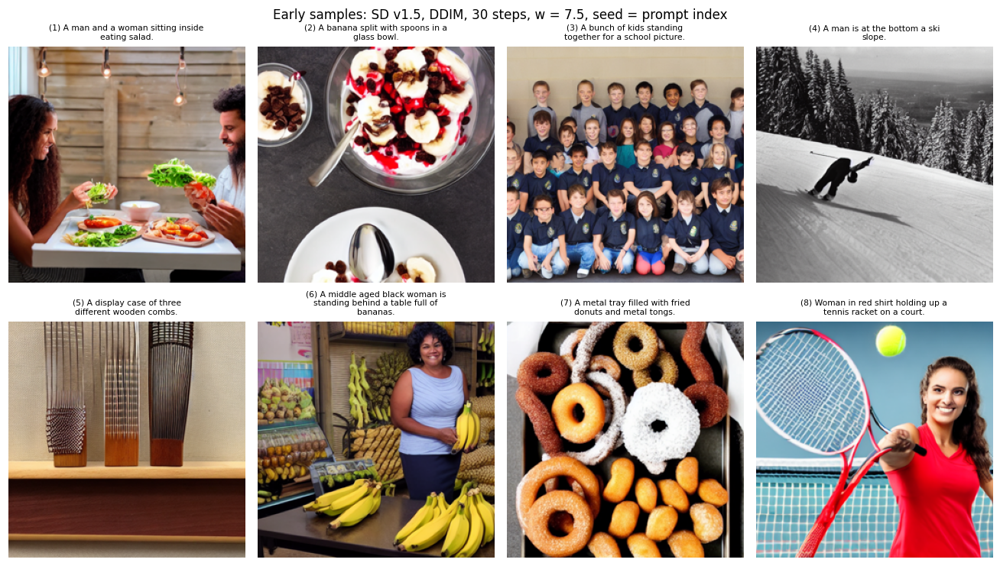

Table 2. What each early sample gets right and wrong.

| # | Caption | CLIP | Correct | Wrong or missing |
|---|---|---|---|---|
| 1 | A man and a woman sitting inside eating salad. | 28.6 | man, woman, salad, indoor setting | nothing we could see |
| 2 | A banana split with spoons in a glass bowl. | 25.4 | glass bowl, spoons, banana slices | looks more like a fruit parfait than a banana split |
| 3 | A bunch of kids standing together for a school picture. | 23.6 | a posed group of children in uniforms | the front rows are sitting or kneeling, not standing |
| 4 | A man is at the bottom a ski slope. | 23.2 | a skier on a snowy slope | he is halfway down the slope, not at the bottom; the body is distorted and the image is black and white |
| 5 | A display case of three different wooden combs. | 34.1 | three combs with wooden bases | no display case; the combs look like brushes |
| 6 | A middle aged black woman is standing behind a table full of bananas. | 30.2 | woman, table full of bananas, market setting | nothing we could see |
| 7 | A metal tray filled with fried donuts and metal tongs. | 29.2 | metal tray of donuts | no tongs |
| 8 | Woman in red shirt holding up a tennis racket on a court. | 25.0 | woman, red shirt, racket, court | the racket strings and the hand holding it are slightly malformed |

All eight images have the right main subject and look like photographs. The errors are the same kind we saw in Milestone 1. A secondary object is left out (the tongs, the display case) and a spatial phrase is ignored ("at the bottom" of the slope). The scores also show a weakness of CLIP score. Image 5 has the highest score of the eight although it has no display case and the combs are wrong, and image 3, which is a correct school picture apart from the pose, scores only 23.6. CLIP score is good at telling whether the main content is there but much less sensitive to whether the details are right, so we always look at the images as well.

## 5. Experiment 1: baseline on 200 COCO captions

Table 3. Baseline results (`results/baseline_summary.json`).

| Measure | Value |
|---|---|
| CLIP score, generated images | 26.96 ± 0.45 (range 18.7 to 34.5) |
| CLIP score, real COCO photos with the same captions | 25.87 ± 0.55 |
| Captions where the generated image scores higher than the real photo | 55% |
| Mean saturation | 0.307 |
| Time per image | 4.5 s |

The generated images score about one point higher than the real photos. This does not make them better images. A real photo shows many things its caption does not mention, while the model draws what the caption says, usually centered and clearly visible, and that is what CLIP rewards. Figure 2 shows six examples. The generated images are cleaner and more centered than the photos, and for the ski slope caption the real photo actually fits the caption better. For this reason Milestone 3 adds FID, which compares the generated and real images as two sets instead of scoring each image against its caption.

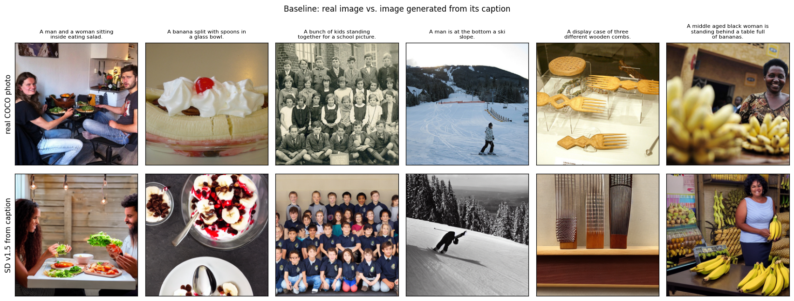

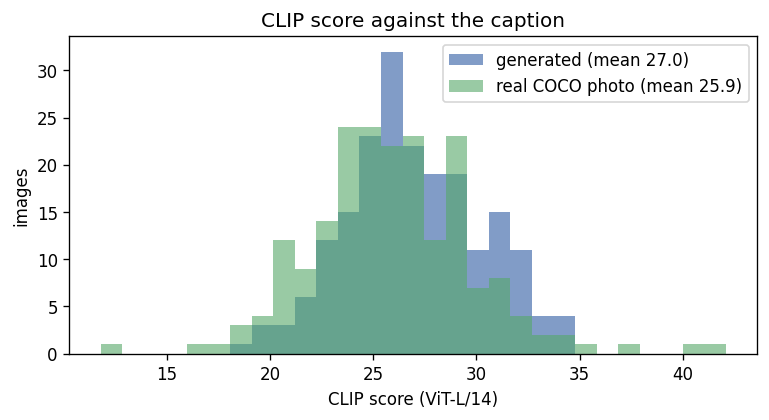

Most of the lowest-scoring images (Figure 4, top row) are real failures. "An airplane leaving a trail in the sky" turned into a blue shape that is half plane and half bird, the "toilet with glitter paint" has no glitter, and the oven has no pot or kettle. The fourth caption, "There is a person holding a cell phone in their hand", produced a correct image that still scored low, another case where CLIP score is misleading. The highest-scoring images (bottom row) come from simple captions about clear, concrete objects, such as an orange calico cat on a car.

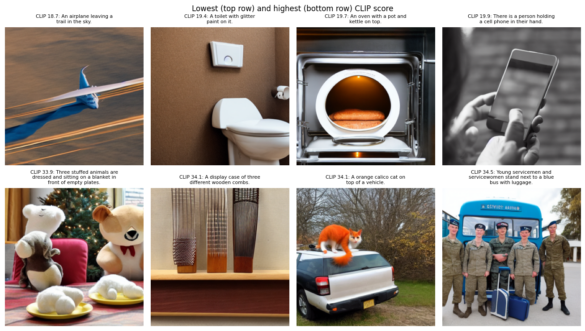

## 6. Experiment 2: classifier-free guidance scale

We generated the same 32 captions with two seeds each at six guidance scales. At w = 1 the unconditional prediction drops out of the formula, so this is the model without guidance.

Table 4. Guidance sweep (`results/guidance_sweep_summary.json`). The last column is the paired difference in CLIP score from w = 7.5 over the same 64 caption and seed pairs.

| w | CLIP score | Seed diversity | Saturation | Clipped pixels | CLIP vs. w = 7.5 |
|---|---|---|---|---|---|
| 1 | 21.93 ± 0.99 | 0.280 ± 0.027 | 0.212 | 0.05% | −4.54 ± 1.16 |
| 3 | 25.31 ± 0.95 | 0.199 ± 0.026 | 0.249 | 0.21% | −1.16 ± 0.68 |
| 5 | 25.83 ± 1.11 | 0.168 ± 0.028 | 0.288 | 0.68% | −0.64 ± 0.53 |
| 7.5 | 26.46 ± 1.15 | 0.154 ± 0.027 | 0.322 | 1.41% | 0 |
| 10 | 26.52 ± 1.05 | 0.129 ± 0.020 | 0.350 | 2.22% | +0.05 ± 0.41 |
| 15 | 26.88 ± 1.04 | 0.125 ± 0.019 | 0.390 | 3.92% | +0.41 ± 0.46 |

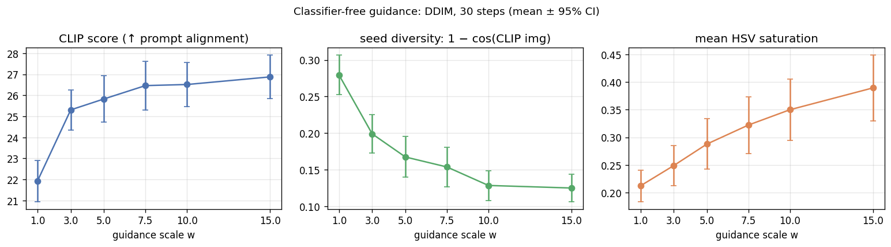

CLIP score rises by 3.4 points from w = 1 to w = 3, and the images change from incoherent to recognizable (Figure 6, first column). From w = 3 to w = 7.5 it rises by another 1.2 points, which is significant in the paired comparison. Above 7.5 the changes are within the confidence intervals (+0.05 at w = 10 and +0.41 at w = 15). Diversity and color keep changing, though. Seed diversity at w = 15 is less than half its value at w = 1, saturation increases steadily from 0.21 to 0.39, and the fraction of clipped pixels is almost three times higher at w = 15 than at w = 7.5. In Figure 6 the images at high guidance look flatter and more saturated, and for the second salad seed the composition changes completely at w = 10 and 15. For SD v1.5 on COCO captions, w = 7.5 gives almost all of the prompt alignment without the loss of diversity and the oversaturation seen at higher scales.

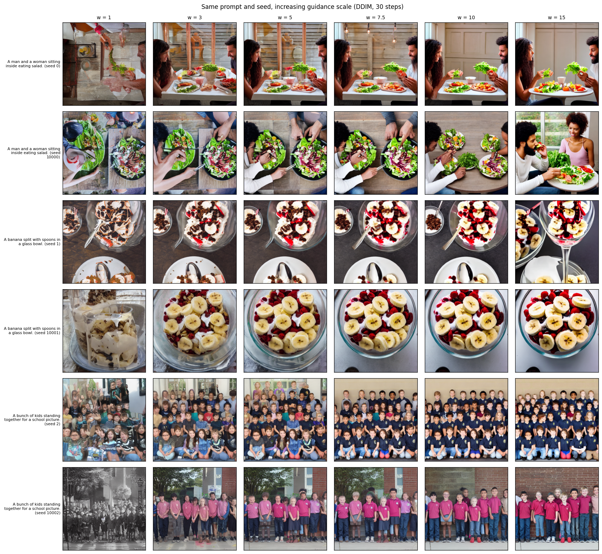

In Milestone 1 we planned to test whether higher guidance reduces the missing-object errors. The small CLIP score change above w = 7.5 does not answer this, because CLIP score does not check whether every object is present (Section 4). In Milestone 3 we will count the objects named in multi-object captions at each guidance scale, and also try a different text encoder.

## 7. Experiment 3: scheduler and number of sampling steps

We ran six schedulers at 10, 25 and 50 steps with w = 7.5 on 24 captions. DDIM, PNDM, Euler and DPM-Solver++ are deterministic, so the same starting noise always gives the same image. DDPM and Euler ancestral add new noise at every step.

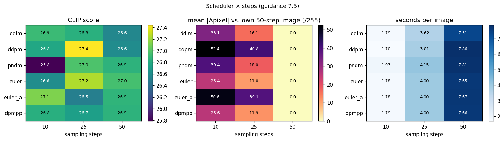

The scheduler and the step count did not change CLIP score. All 18 configurations score between 25.8 and 27.4, with 95% intervals of about ±1.4. In paired comparisons on the same 24 captions, no scheduler at 10 or 25 steps is significantly different from the same scheduler at 50 steps. The largest drop is PNDM at 10 steps, 1.07 ± 1.24 below PNDM at 50 steps. These images are visibly softer, but with 24 captions the difference is not significant. With any of these samplers, 10 steps are enough to get the content of the caption into the image.

The step count does change how close the image is to its final version. For the deterministic samplers the distance to the 50-step image decreases with more steps. At 25 steps it is 11 to 12 (out of 255) for Euler and DPM++, 16 for DDIM and 18 for PNDM. Euler and DPM++ converge fastest, and at 25 steps their images differ from the 50-step images only in small details (Figure 8, rows 4 and 6). DDPM and Euler ancestral are still 39 to 41 away at 25 steps, because the added noise leads to a different image at each step count. Their CLIP scores are just as good, but the image changes whenever the number of steps changes. DDPM and Euler ancestral also produce very similar images to each other at 25 and 50 steps (Figure 8, rows 2 and 5). Both draw their noise from the same seeded generator, which is the likely reason.

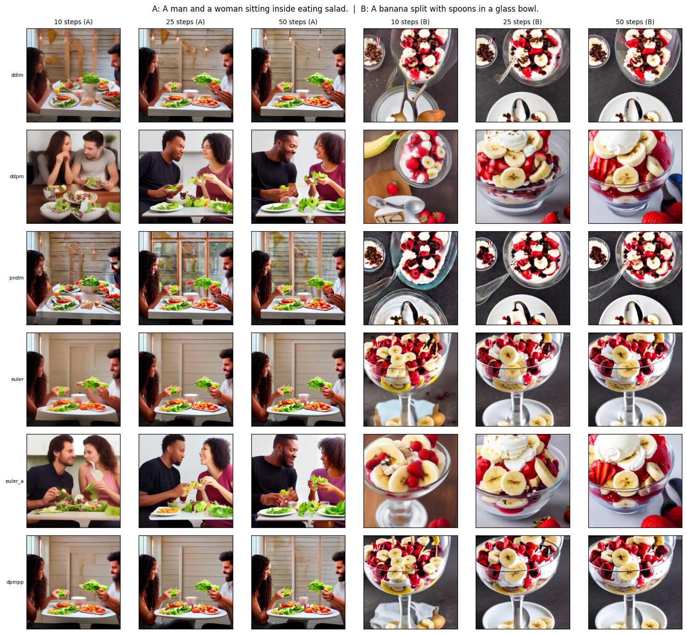

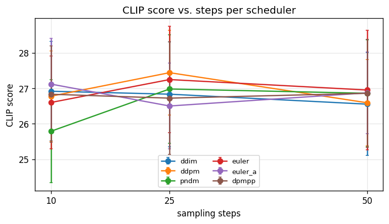

The time per image depends only on the number of steps (1.8 s, 4.0 s and 7.7 s), because the U-Net runs once per step for every scheduler and takes almost all of the time. Euler or DPM++ at 25 steps gives the same CLIP score as 50 steps in half the time, and the image is close to the 50-step one. We will use this setting for the larger image sets in Milestone 3.

## 8. Experiment 4: noise schedule

The scheduler defines how each step is taken, and the noise schedule defines which noise levels σ the steps go through. We kept the sampler fixed (Euler, w = 7.5) and compared four ways of spacing the steps, each at 10 and 25 steps, with the leading schedule at 50 steps as the reference.

- Leading is the SD v1.5 default. With 10 steps the first step is at timestep 901, so sampling starts at σ = 8.4 and not from pure noise (σ = 14.6 at timestep 999).
- Linspace and trailing both start at timestep 999 with σ = 14.6. Trailing stops earlier (σ = 0.34 at 10 steps) and removes the remaining noise in the last step.
- Karras uses the σ spacing of Karras et al. (2022), which puts more steps at low noise levels. In Diffusers it takes its highest and lowest σ from the leading schedule, so it also starts at 8.4.

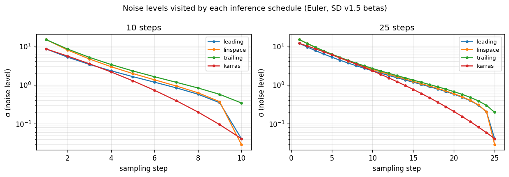

Table 5. Noise schedule results (`results/noise_schedule_summary.json`). The paired difference is against the leading schedule with the same number of steps.

| Schedule | Steps | First σ | CLIP score | Paired diff. vs. leading | Pixel distance to reference |
|---|---|---|---|---|---|
| leading | 10 | 8.39 | 26.98 ± 1.44 | 0 | 33.1 |
| linspace | 10 | 14.61 | 26.60 ± 1.31 | −0.38 ± 0.49 | 26.1 |
| trailing | 10 | 14.61 | 26.92 ± 1.43 | −0.06 ± 0.65 | 25.7 |
| karras | 10 | 8.39 | 26.73 ± 1.45 | −0.25 ± 0.44 | 32.8 |
| leading | 25 | 11.68 | 26.91 ± 1.49 | 0 | 16.2 |
| linspace | 25 | 14.61 | 27.25 ± 1.50 | +0.33 ± 0.59 | 17.9 |
| trailing | 25 | 14.61 | 27.30 ± 1.52 | +0.38 ± 0.61 | 17.6 |
| karras | 25 | 11.68 | 26.65 ± 1.41 | −0.26 ± 0.36 | 15.6 |
| leading (reference) | 50 | | 26.74 ± 1.48 | | 0 |

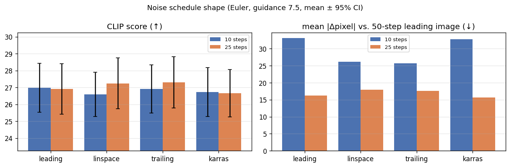

As with the schedulers, no noise schedule changed CLIP score significantly, and every paired difference is within its confidence interval. Trailing and linspace at 25 steps have the highest means, but by only about 0.4 points. The schedules do differ in where sampling starts, and this changes the image. At 10 steps, linspace and trailing, which start from pure noise, end up about 7 points closer to the 50-step reference than leading and Karras, which start at σ = 8.4. At 25 steps leading starts higher (σ = 11.7) and all four schedules are about equally far from the reference. Because the leading default never starts from pure noise, it is known to have trouble producing very dark or very bright images (Lin et al., 2024). We did not see this with COCO captions, which rarely describe such scenes, but it is a reason to use trailing spacing for prompts that do.

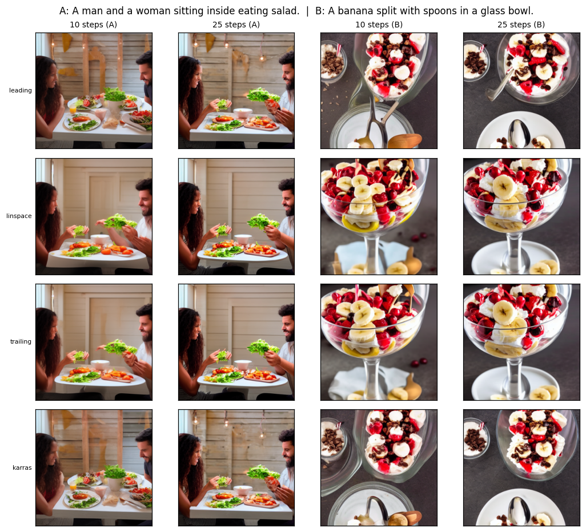

## 9. Conclusions and next steps

Guidance is the setting that matters most. CLIP score rises quickly up to w = 3, more slowly up to 7.5 and not significantly after that, while diversity goes down and saturation goes up the whole way, so w = 7.5 is a good default. The scheduler, the step count and the noise schedule did not change CLIP score in our tests with 24 captions. They change how fast the image converges and whether it stays the same when the number of steps changes, and Euler or DPM++ at 25 steps matches 50 steps in half the time. CLIP score on its own is not enough, since it rates generated images above real photos and does not notice wrong details. The main failures are compositional: secondary objects and spatial relations are often left out.

In Milestone 3 we will compute FID and Inception Score with torchmetrics on 1,000 to 2,000 generated images against COCO val2017, using Euler or DPM++ at 25 steps so the run fits in a Colab session. We will repeat the guidance sweep with FID to see how image quality, and not only alignment, changes with w, and count objects in multi-object captions to see whether guidance reduces the missing-object errors. We will also replace the CLIP text encoder with BERT, passing its embeddings through the `prompt_embeds` input we checked in Milestone 1. Finally, we will rerun the scheduler and noise schedule comparisons on more captions, because 24 captions are not enough to separate settings that differ by less than one point.

## 10. Roles

| Member | Milestone 2 work |
|---|---|
| Anshuman Singh | experiment scripts, Colab runs, scheduler and noise schedule experiments, repository |
| Rohan Prakash Krishna Prakash | caption selection from the Milestone 1 subset, real-image comparison in the baseline, data checks |
| Sree Ramya Pasala | CLIP scoring, diversity and saturation measures, figures, report |

## References

- Ho, J. and Salimans, T. (2021). Classifier-free diffusion guidance. NeurIPS 2021 Workshop on Deep Generative Models.
- Hessel, J., Holtzman, A., Forbes, M., Le Bras, R. and Choi, Y. (2021). CLIPScore: A reference-free evaluation metric for image captioning. EMNLP.
- Karras, T., Aittala, M., Aila, T. and Laine, S. (2022). Elucidating the design space of diffusion-based generative models. NeurIPS.
- Lin, S., Liu, B., Li, J. and Yang, X. (2024). Common diffusion noise schedules and sample steps are flawed. WACV.
- Lin, T.-Y. et al. (2014). Microsoft COCO: Common objects in context. ECCV.
- Radford, A. et al. (2021). Learning transferable visual models from natural language supervision. ICML.
- Rombach, R., Blattmann, A., Lorenz, D., Esser, P. and Ommer, B. (2022). High-resolution image synthesis with latent diffusion models. CVPR.
