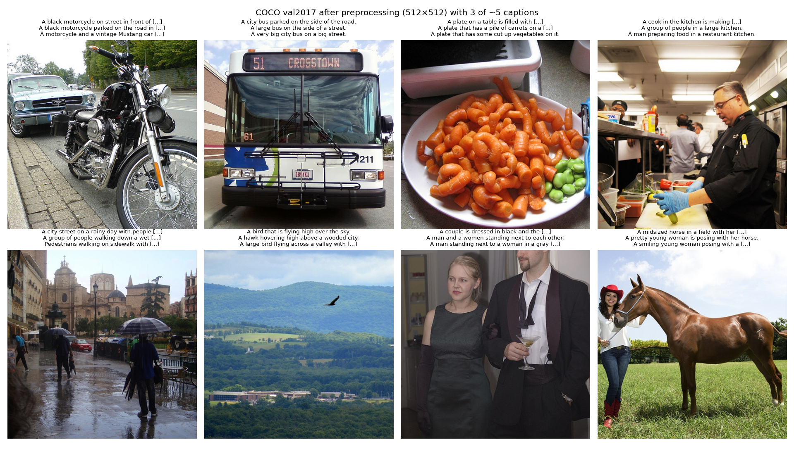
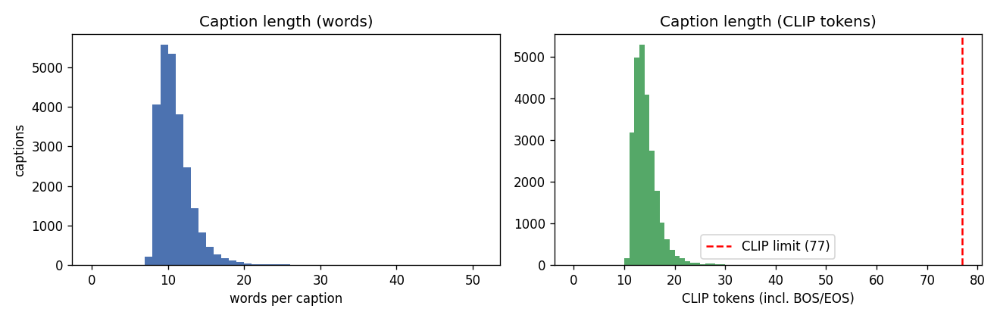
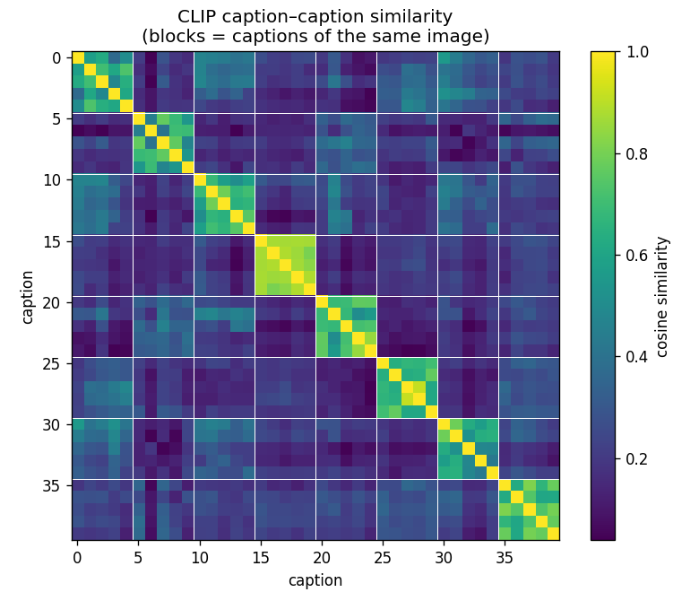
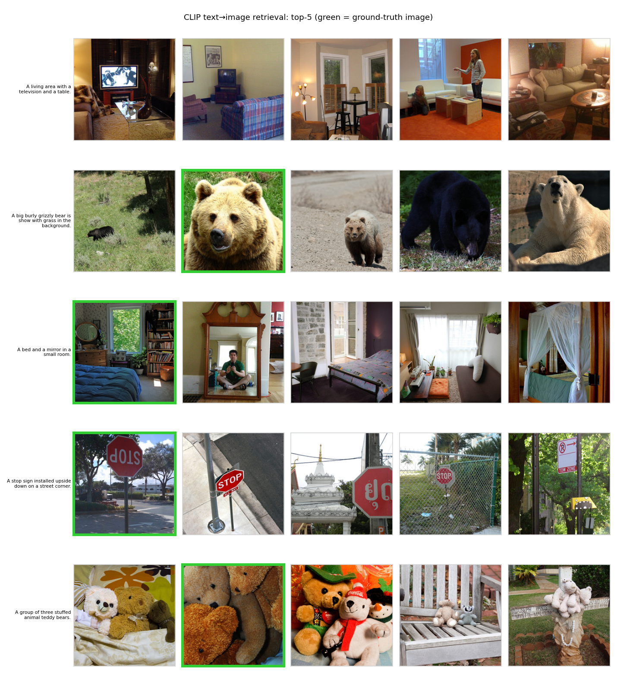
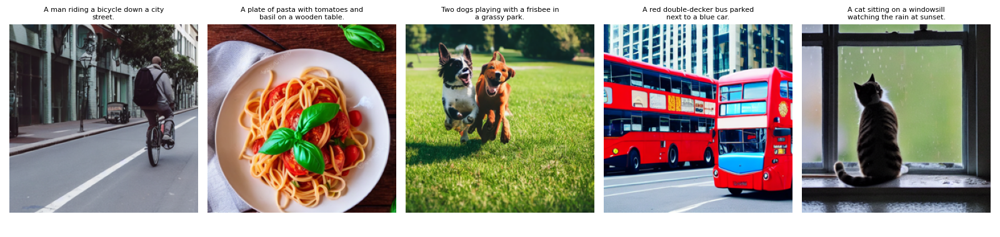
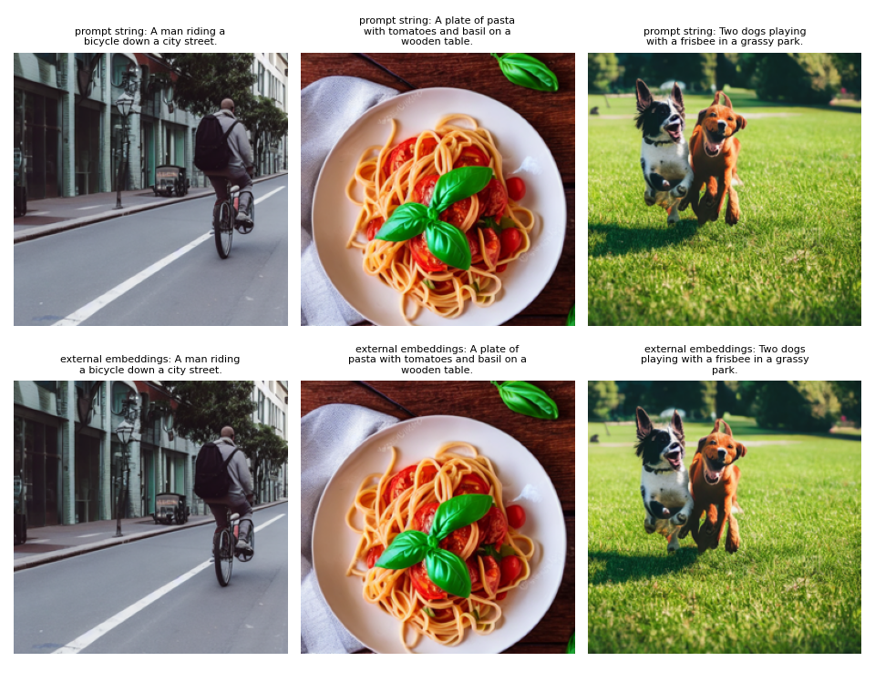

# Project Proposal & Setup – From Words to Worlds (Milestone 1)

**Northeastern University · IE 7615 · Fall 2026 · Generative Project · _Date TBD_**

**Group 1**

| Name | NUID |
|---|---|
| Anshuman Singh | 002590892 |
| Rohan Prakash Krishna Prakash | 002317798 |
| Sree Ramya Pasala | 002301508 |

PDF version: [Milestone1_Report.pdf](Milestone1_Report.pdf)

## Repository

GitHub: <https://github.com/anshuman-dataverse/generative-deep-learning-project>

Code, results and figures are in the milestone1/ folder of the repository. The whole milestone runs on Google Colab from [milestone1_colab.ipynb](../notebooks/milestone1_colab.ipynb).

## 1. Summary

We are building a text-to-image pipeline in which a Transformer text encoder (**CLIP ViT-L/14**) conditions a pre-trained latent diffusion model (**Stable Diffusion v1.5**). We will then measure how the conditioning choices (guidance scale, noise scheduler, number of sampling steps, text encoder) trade off image fidelity, diversity and prompt alignment. Milestone 1 delivers the dataset, the text→embedding pipeline, embedding sanity checks and the first 5 prompt→image samples.

_Results paragraph: fill in from results/*.json after the Colab run._

## 2. Objective

Generate images from text with a Transformer encoder and a diffusion model, then evaluate them quantitatively (FID, Inception Score, CLIP score) and qualitatively (prompt–image alignment), and analyze fidelity vs. diversity and the ethical risks. Milestone 1 covers the dataset choice and preprocessing, the environment, the text→embedding pipeline and the baseline test runs.

## 3. Dataset

### 3.1 Choice: COCO Captions 2017 (val)

| Property | Value |
|---|---|
| Images | 5,000 natural photos, 80 object categories, multi-object everyday scenes |
| Captions | ~5 human-written captions per image (~25k total) |
| Why | standard reference set for text-to-image FID (comparable to published numbers); compositional scenes test alignment; 5k images fit the 1k–5k scope without the 18 GB train split |

Alternatives considered: Flickr30k (people-centric, rarely used for FID) and a LAION-400M subset (noisy web alt-text, and broken links make it hard to reproduce).

### 3.2 Cleaning and preprocessing

| Step | Detail |
|---|---|
| Captions | whitespace normalization, capitalized, single trailing period, exact duplicates per image removed, captions under 3 words dropped |
| Subset | seeded random sample (seed 42) of _N_ images (default all 5,000) |
| Images | RGB, shorter side resized to 512 (bicubic), center-crop 512×512, which is SD v1.5's native resolution |
| Tensors | `ToTensor` + `Normalize(0.5, 0.5)` → [-1, 1], the VAE input range |
| Tokens | CLIP BPE tokenizer, padded/truncated to 77 tokens |

_Table from results/dataset_stats.json: images, captions, captions per image, mean words, mean/max CLIP tokens, captions over 77 tokens._

## 4. Model

| Component | Model | Role |
|---|---|---|
| Text encoder | CLIP ViT-L/14 text transformer (123M params, 12 layers) | caption → per-token embeddings (77×768) + pooled embedding (768) |
| Denoiser | SD v1.5 U-Net (860M params) with cross-attention | predicts noise ε(x_t, t, c), attending to the 77×768 text context |
| Autoencoder | SD v1.5 VAE | 512×512×3 image ↔ 64×64×4 latent |
| Schedulers | DDIM, DDPM, PNDM, Euler, Euler-A, DPM-Solver++ | reverse-diffusion samplers sharing the trained β-schedule |
| Guidance | classifier-free, ε̂ = ε(x_t, ∅) + w·(ε(x_t, c) − ε(x_t, ∅)) | trades alignment for diversity |

Our own encoder wrapper (`t2i/embeddings.py`) produces the conditioning tensor, and `t2i/generate.py` passes it to the U-Net as `prompt_embeds`. This lets later milestones swap or modify the text representation (BERT, interpolation, prompt weighting).

## 5. Text → embedding pipeline and sanity checks

1. **Caption similarity:** captions of the same image should be closer than captions of different images.
2. **Text→image retrieval:** CLIP's text and image towers share one space, so each image should be found from its own caption among the candidate images.

_Table from results/embedding_checks.json: same vs. different image similarity, AUC, Recall@1/5/10 vs. chance, median rank._

## 6. First test runs (5 prompts)

Settings: SD v1.5, DDIM, 30 steps, guidance 7.5, 512×512, seed 0 + i, fp16 on a Tesla T4.

_Per-prompt observations: what is right, what is wrong (counting, colour binding, hands, text)._

**Conditioning check:** with the same seeds, images conditioned on our own CLIP embeddings match the built-in prompt path (mean absolute pixel difference _x_ / 255, from results/conditioning_check.json).

## 7. Plan

| Milestone | Week | Work |
|---|---|---|
| 1 | 1–2 | dataset, environment, text→embedding pipeline, 5 test samples, repo (this report) |
| 2 | 3–4 | baseline generation over COCO captions; guidance scale w ∈ {1, 3, 5, 7.5, 10, 15}; schedulers × steps {10, 25, 50} |
| 3 | 5 | FID / IS (torchmetrics) on 1–2k images vs. COCO val references; CLIP score; sensitivity plots; text-encoder comparison |
| 4 | 7 (Dec 13) | final report, gallery, slides and demo video |

Extensions if time allows: GPT-style text embeddings, style control through extra conditioning, a web demo.

## 8. Roles

| Member | Responsibilities |
|---|---|
| Anshuman Singh | _TBD_ |
| Rohan Prakash Krishna Prakash | _TBD_ |
| Sree Ramya Pasala | _TBD_ |

## 9. Ethical considerations (planned)

COCO's demographic and geographic skew; social stereotypes inherited from SD's LAION training data; misuse (deepfakes, non-consensual imagery); and copyright and artist-style imitation. The safety checker is disabled for benign COCO prompts (false positives black out images and bias FID) and enabled for any public demo.
