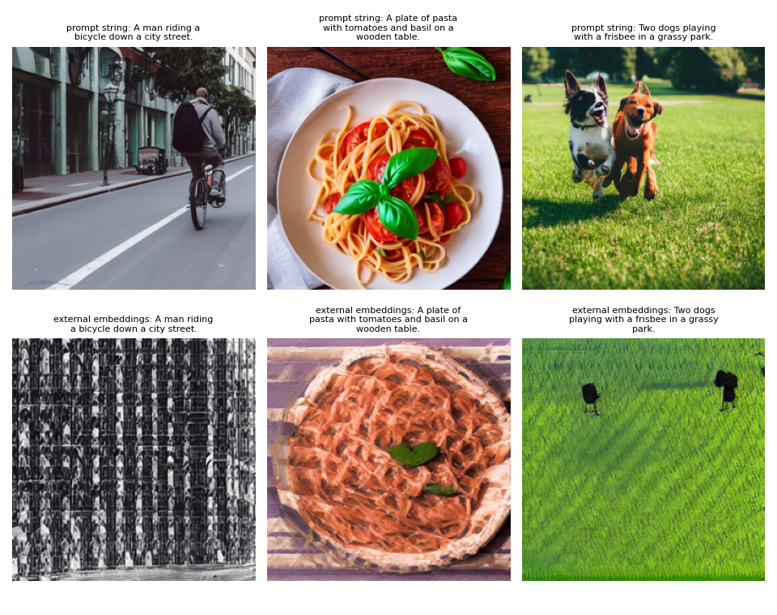

# Project Proposal & Setup – From Words to Worlds (Milestone 1)

**Northeastern University · IE 7615 · Fall 2026 · Generative Project · _Date TBD_**

**Group 1**

| Name | NUID |
|---|---|
| Anshuman Singh | 002590892 |
| Rohan Prakash Krishna Prakash | 002317798 |
| Sree Ramya Pasala | 002301508 |

PDF version: [Milestone1_Report.pdf](Milestone1_Report.pdf)

## Repository

GitHub: <https://github.com/anshuman-dataverse/text-to-image-generation>

Code, results and figures are in the milestone1/ folder of the repository. The whole milestone runs on Google Colab from [milestone1_colab.ipynb](../notebooks/milestone1_colab.ipynb).

## 1. Summary

We are building a text-to-image pipeline in which a Transformer text encoder (**CLIP ViT-L/14**) conditions a pre-trained latent diffusion model (**Stable Diffusion v1.5**). We will then measure how the conditioning choices (guidance scale, noise scheduler, number of sampling steps, text encoder) trade off image fidelity, diversity and prompt alignment. Milestone 1 delivers the dataset, the text→embedding pipeline, embedding sanity checks and the first 5 prompt→image samples.

The pipeline ran end to end on a Colab Tesla T4. All **5,000 COCO val2017 images and 25,000 captions** passed cleaning, and no caption exceeds CLIP's 77-token window (max 58). The CLIP embeddings behave as conditioning should. Captions of the same image are far closer than captions of different images (cosine 0.656 vs. 0.234, pairwise AUC 0.985). CLIP retrieves the right image from its caption among 1,000 candidates **54.9%** of the time at rank 1 and **89.7%** within the top 10 (chance 0.1% / 1%). Stable Diffusion produced 5 plausible 512×512 samples at 7.5 s/image. They already show the classic failure modes we will study: a dropped object (the frisbee) and attribute leakage (the "blue car" became a blue-fronted bus). Feeding our own embeddings to the U-Net first exposed a subtle bug: masking CLIP's padding tokens changes 60+ of the 77 conditioning positions and degrades the images. After the fix, our embeddings match SD's own encoding bit for bit and produce pixel-identical images (Section 6).

## 2. Objective

Generate images from text with a Transformer encoder and a diffusion model, then evaluate them quantitatively (FID, Inception Score, CLIP score) and qualitatively (prompt–image alignment), and analyze fidelity vs. diversity and the ethical risks. Milestone 1 covers the dataset choice and preprocessing, the environment, the text→embedding pipeline and the baseline test runs.

## 3. Dataset

### 3.1 Choice: COCO Captions 2017 (val)

| Property | Value |
|---|---|
| Images | 5,000 natural photos, 80 object categories, multi-object everyday scenes |
| Captions | ~5 human-written captions per image (~25k total) |
| Why | standard reference set for text-to-image FID (comparable to published numbers); compositional scenes test alignment; 5k images fit the 1k–5k scope without the 18 GB train split |

Alternatives considered: Flickr30k (people-centric, rarely used for FID) and a LAION-400M subset (noisy web alt-text, and broken links make it hard to reproduce).

### 3.2 Cleaning and preprocessing

| Step | Detail |
|---|---|
| Captions | whitespace normalization, capitalized, single trailing period, exact duplicates per image removed, captions under 3 words dropped |
| Subset | seeded random sample (seed 42) of _N_ images (default all 5,000) |
| Images | RGB, shorter side resized to 512 (bicubic), center-crop 512×512, which is SD v1.5's native resolution |
| Tensors | `ToTensor` + `Normalize(0.5, 0.5)` → [-1, 1], the VAE input range |
| Tokens | CLIP BPE tokenizer, padded/truncated to 77 tokens |

| **Statistic** (results/dataset_stats.json) | **Value** |
|---|---|
| Images / captions after cleaning | 5,000 / 25,000 (none removed) |
| Captions per image | 5.0 |
| Words per caption: mean (min–max) | 10.44 (7–50) |
| CLIP tokens per caption: mean / max | 13.78 / 58 |
| Captions truncated at 77 tokens | 0 |
| Image size | 512×512 |

COCO captions are short and literal (about 10 words), so truncation is never an issue. The real constraint is that the prompts describe ordinary scenes rather than artistic styles. That makes COCO a good test of *content* alignment, and a poor test of style control.

## 4. Model

| Component | Model | Role |
|---|---|---|
| Text encoder | CLIP ViT-L/14 text transformer (123M params, 12 layers) | caption → per-token embeddings (77×768) + pooled embedding (768) |
| Denoiser | SD v1.5 U-Net (860M params) with cross-attention | predicts noise ε(x_t, t, c), attending to the 77×768 text context |
| Autoencoder | SD v1.5 VAE | 512×512×3 image ↔ 64×64×4 latent |
| Schedulers | DDIM, DDPM, PNDM, Euler, Euler-A, DPM-Solver++ | reverse-diffusion samplers sharing the trained β-schedule |
| Guidance | classifier-free, ε̂ = ε(x_t, ∅) + w·(ε(x_t, c) − ε(x_t, ∅)) | trades alignment for diversity |

Our own encoder wrapper (`t2i/embeddings.py`) produces the conditioning tensor, and `t2i/generate.py` passes it to the U-Net as `prompt_embeds`. This lets later milestones swap or modify the text representation (BERT, interpolation, prompt weighting).

## 5. Text → embedding pipeline and sanity checks

1. **Caption similarity:** captions of the same image should be closer than captions of different images.
2. **Text→image retrieval:** CLIP's text and image towers share one space, so each image should be found from its own caption among the candidate images.

| **Check** (results/embedding_checks.json) | **Result** |
|---|---|
| Caption cosine similarity, same image (1,000 images, 5,000 captions) | 0.656 |
| Caption cosine similarity, different images | 0.234 |
| P(same-image pair > different-image pair) | 0.985 |
| Text→image Recall@1 / @5 / @10 (1,000 images) | 54.9% / 81.1% / 89.7% |
| Chance @1 / @5 / @10 | 0.1% / 0.5% / 1.0% |
| Median rank of the correct image | 1 |

Retrieval is 549× better than chance at rank 1. The misses are informative: for "A living area with a television and a table" all five top images are living rooms with TVs, but not the right one. COCO captions often fit several images equally well, so Recall@1 understates alignment. This matters for Milestone 3, where CLIP score will judge generated images. CLIP rewards matching the caption's content, not reproducing the reference photo.

## 6. First test runs (5 prompts)

Settings: SD v1.5, DDIM, 30 steps, guidance 7.5, 512×512, seed 0 + i, fp16 on a Tesla T4, **7.5 s per image** (with attention slicing on).

| Prompt | Correct | Wrong / missing |
|---|---|---|
| A man riding a bicycle down a city street | rider, bicycle, street, lane markings, buildings | n/a; photorealistic and coherent |
| A plate of pasta with tomatoes and basil on a wooden table | all four objects, plausible food styling | n/a |
| Two dogs playing with a frisbee in a grassy park | **count is right** (two dogs), park, playful pose | **frisbee missing** (object omission) |
| A red double-decker bus parked next to a blue car | red double-decker bus | **no blue car**: the blue leaked onto a second bus's front (attribute leakage) |
| A cat sitting on a windowsill watching the rain at sunset | cat, windowsill, raindrops on the glass | "sunset" is ignored (grey daylight); the third concept in the prompt is dropped |

The model handles single-subject scenes well and degrades as prompts list more objects and attributes. This is the known weakness of CLIP-conditioned diffusion with compositional prompts, and Milestone 2 will test whether higher guidance helps.

### Conditioning check: our embeddings → U-Net

We encode the 5 prompts with our own `TextEncoder` and pass the 77×768 tensor to the U-Net as `prompt_embeds`, using the same seeds as above. If our encoding matches SD's, the images must be identical.

**First run (bug):** the images differed by 47–78 / 255 on average, and three of them broke down completely (below). Our encoder passed CLIP an `attention_mask`, but SD's pipeline does not. Because CLIP's text transformer is causal, the real tokens and the pooled EOS embedding are **bit-identical** either way (we verified this). The 60+ **padding positions**, however, change, and the U-Net cross-attends to all 77. So SD v1.5 has learned to read conditioning from the padding tokens, which is a useful fact for later experiments that edit embeddings. Cached pooled embeddings and the checks in Section 5 are unaffected.

**After the fix** (no mask, matching SD): the 77×768 tensors from our encoder equal the pipeline's own text encoding exactly (max abs difference 0.0 at every position), and all 5 images are pixel-identical (mean abs difference 0.0 / 255). External embeddings from `TextEncoder` can therefore drive the U-Net in later milestones with no hidden change in conditioning. A full rerun of steps 01–04 also reproduced every other result and sample image byte for byte.

## 7. Plan

| Milestone | Week | Work |
|---|---|---|
| 1 | 1–2 | dataset, environment, text→embedding pipeline, 5 test samples, repo (this report) |
| 2 | 3–4 | baseline generation over COCO captions; guidance scale w ∈ {1, 3, 5, 7.5, 10, 15}; schedulers × steps {10, 25, 50} |
| 3 | 5 | FID / IS (torchmetrics) on 1–2k images vs. COCO val references; CLIP score; sensitivity plots; text-encoder comparison |
| 4 | 7 (Dec 13) | final report, gallery, slides and demo video |

Extensions if time allows: GPT-style text embeddings, style control through extra conditioning, a web demo.

## 8. Roles

| Member | Responsibilities |
|---|---|
| Anshuman Singh | _TBD_ |
| Rohan Prakash Krishna Prakash | _TBD_ |
| Sree Ramya Pasala | _TBD_ |

## 9. Ethical considerations (planned)

COCO's demographic and geographic skew; social stereotypes inherited from SD's LAION training data; misuse (deepfakes, non-consensual imagery); and copyright and artist-style imitation. The safety checker is disabled for benign COCO prompts (false positives black out images and bias FID) and enabled for any public demo.
